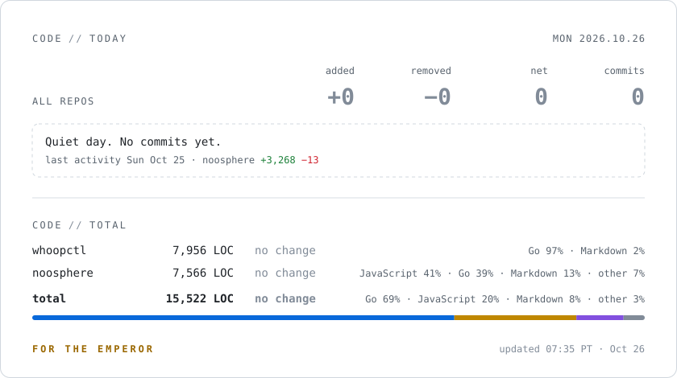

<picture>
  <source media="(prefers-color-scheme: dark)" srcset="./assets/code-stats-dark.svg">
  
</picture>
<picture>
  <source media="(prefers-color-scheme: dark)" srcset="https://profile-views.tianbo-dev.workers.dev/views.svg?theme=dark">
  
</picture>
